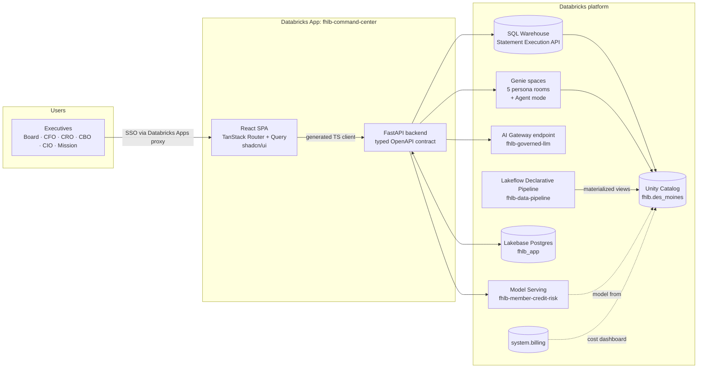
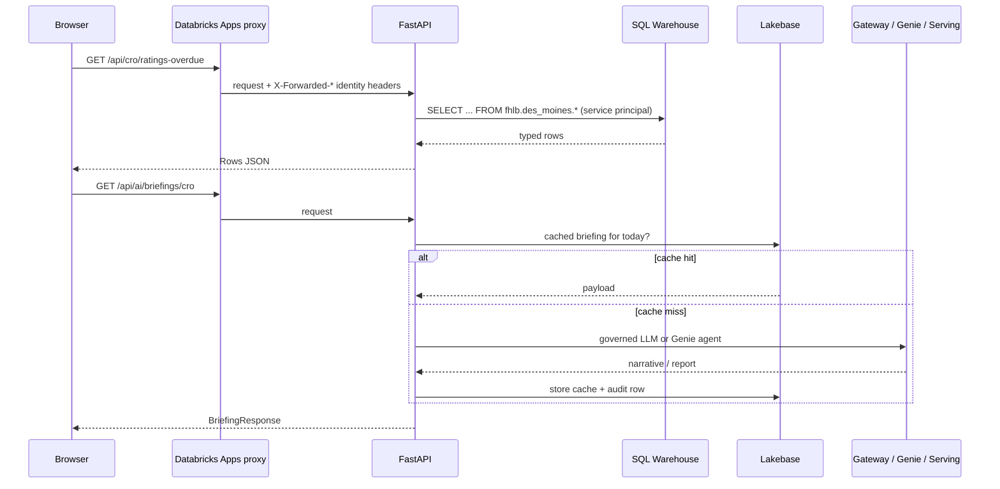
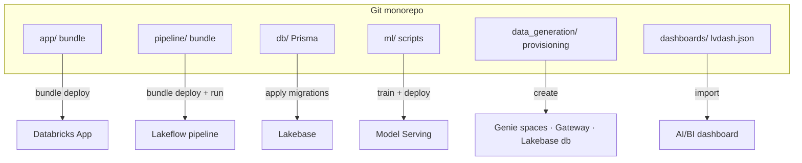

# FHLB Des Moines — Executive Command Center

A governed, AI-native executive cockpit built as a **Databricks App** on top of
the Databricks lakehouse. Each member of the leadership team (Board/CEO, CFO, CRO,
CBO, CIO, Community Investment) gets a persona-specific view over the same
governed data, with a Genie research agent, a governed LLM, a classical ML
credit-risk model, and a Postgres-backed system of engagement.

> Everything is code and deploys as Databricks Asset Bundles. The demo uses
> **synthetic data** generated for a fictional bank profile; no real member data
> is in this repository.

For the business walkthrough see [`DEMO_SCRIPT.md`](./DEMO_SCRIPT.md). For how this
was built with Cursor see [`docs/`](./docs).

---

## Contents

- [Design principles](#design-principles)
- [Architecture](#architecture)
- [Components](#components)
- [Application design](#application-design)
- [Data flow patterns](#data-flow-patterns)
- [Data model](#data-model)
- [Governance and security](#governance-and-security)
- [Repository layout](#repository-layout)
- [Configuration](#configuration)
- [Getting started](#getting-started)
- [Deployment](#deployment)
- [Current limitations](#current-limitations)

---

## Design principles

1. **One governed source of truth.** Every number on screen traces to Unity
   Catalog tables in `fhlb.des_moines`. No extracts, no side copies.
2. **Persona-first UX.** One cockpit per leader, one shared shell, consistent
   components. The questions each persona asks drive the data model.
3. **Governed AI, not bolted-on AI.** All LLM traffic goes through an AI Gateway
   endpoint (PII guardrails, rate limits, inference logging). Genie answers come
   from approved tables only.
4. **Right store for the right job.** Analytics in the lakehouse, app state in
   Lakebase (Postgres), predictions on Model Serving.
5. **Expensive work is cached.** AI briefings, anomaly scans and ML scoring run
   at most once a day per persona (or on demand) and are cached in Lakebase.
6. **Everything is a bundle.** The app, the data pipeline, ML, and dashboards are
   reproducible from source.

---

## Architecture

### System context



### Request path



### Deployment topology



---

## Components

| Component | Technology | Location | Purpose |
|---|---|---|---|
| Web app | React, TanStack Router/Query, Tailwind, shadcn/ui, Recharts/d3 | `app/src/fhlb_command_center/ui` | Persona cockpits and shared shell |
| API | FastAPI, Pydantic, `databricks-sdk`, psycopg | `app/src/fhlb_command_center/backend` | Query routing, AI orchestration, state |
| App bundle | Databricks Asset Bundle, `app.yml`, **apx** | `app/` | Build and deploy the Databricks App |
| Data pipeline | Lakeflow Spark Declarative Pipeline (materialized views) | `pipeline/` | Builds the 38-table `fhlb.des_moines` model |
| App state | Lakebase (Postgres) + Prisma | `db/` | Watchlist, acks, exam packs, audit, caches |
| ML | XGBoost, MLflow, UC model registry, Model Serving | `ml/` | 12-month member credit-deterioration PD |
| Governed LLM | AI Gateway over a Claude foundation model | `data_generation/create_gateway_endpoint.py` | Briefings and the Affordable Housing Assistant |
| NL analytics | Genie spaces (one per persona) + Agent mode | `data_generation/create_genie_spaces.py` | Chat and deep-research anomaly scanning |
| Cost telemetry | AI/BI (Lakeview) dashboard | `dashboards/` | App cost from `system.billing` |

---

## Application design

### Frontend

- **Shell and routing.** A single `AppShell` (left rail, freshness chip, Genie
  dock) wraps file-based TanStack routes: `/` (Overview), `/cfo`, `/cro`, `/cbo`,
  `/cio`, `/mission`, `/architecture`, `/data-model`, `/data-engineering`.
- **Personas as data.** `ui/lib/personas.ts` defines each persona's label,
  executive, headline, accent color and blurb, so the rail, headers and theming
  stay consistent.
- **Typed API client.** The OpenAPI schema emitted by FastAPI generates the
  TypeScript client (`ui/lib/api.ts`). A backend contract change surfaces as a
  frontend compile error.
- **Shared building blocks** (`ui/components/common`): `kpi-card`, `panel`,
  `rows-table` / `rows-view`, `charts`, `district-map`, `ai-briefing`,
  `anomaly-radar`, `early-warning`, `chat-panel`, `genie-box`, `genie-result`,
  and `query-boundary` (loading/error/empty handling for every query).
- **Genie integration.** `genie-agent.ts`, `genie-bus.ts` and `genie-viz.ts`
  stream Agent-mode events and render charts and cited reports in a side dock;
  any panel can send an "Investigate" request to the dock.

### Backend

```
backend/
├── app.py            # create_app(routers=[router])
├── router.py         # all routes; thin handlers
├── models.py         # Pydantic request/response models (the API contract)
├── core/
│   ├── _config.py    # AppConfig: ALL environment-specific settings
│   ├── _factory.py   # app factory, lifespan, middleware
│   ├── _headers.py   # Databricks Apps identity headers
│   ├── dependencies.py  # DI: Client, UserClient, Config, Headers, Lakebase
│   └── _static.py    # serves the built SPA
└── services/
    ├── lakehouse.py     # run_sql via Statement Execution API, typed rows
    ├── queries.py       # SQL for each panel (single place to audit)
    ├── genie.py         # Genie conversations (per-persona space)
    ├── genie_agent.py   # Agent mode SSE proxy -> simplified event stream
    ├── gateway.py       # governed chat() + guardrail verdict metadata
    ├── early_warning.py # builds feature snapshot, calls Model Serving
    └── lakebase.py      # Postgres pool with OAuth credential refresh
```

Route families (see `router.py` for the full list):

| Prefix | Examples |
|---|---|
| `/overview/*` | `kpis`, `district`, `alerts` |
| `/cfo/*` | `advances-vs-forecast`, `sofr-sensitivity`, `co-spreads`, `mbs-unrealized` |
| `/cro/*` | `ratings-overdue`, `oc-cushion`, `concentration`, `early-warning` (+ `POST /score`) |
| `/cbo/*` | `unused-capacity`, `mpf-leakage`, `eadvantage-lurkers`, `prospects` |
| `/cio/*` | `dq-exceptions`, `lineage`, `dual-run-cost`, `model-backlog`, `access-oob` |
| `/mission/*` | `pledge`, `ahp-funnel`, `subsidy-efficiency`, `units-by-tier` |
| `/genie/*`, `/genie-agent/*` | persona chat and streamed deep research |
| `/ai/*` | `narrative`, `briefings/{persona}`, `anomalies/{persona}`, `assistant`, `governance` |
| `/watchlist`, `/alert-acks`, `/exam-requests`, `/annotations` | Lakebase-backed CRUD |

### Design decisions worth knowing

| Decision | Rationale |
|---|---|
| SQL lives in `services/queries.py`, handlers stay thin | One reviewable place for every query hitting the warehouse |
| Generic `Rows` response for analytic panels | New panels need a query and a route, not a new model |
| Persona to Genie space mapping in config | Each room is scoped to the tables that persona needs |
| Caches in Lakebase, not in-process | The app runs multiple workers and restarts; cache must be shared and durable |
| Lakebase credential refresh at 50 min | OAuth DB tokens expire after about 1 hour |
| Early-warning features assembled in SQL, scored remotely | The feature contract is shared with training (`ml/early_warning_model.py`) |
| Resources bound in the bundle, injected via `valueFrom` | No hardcoded ids in deployed config |

---

## Data flow patterns

### 1. Live analytic panels
Browser, then FastAPI, then SQL Warehouse, then Unity Catalog. Rows are typed
(numeric columns cast) and returned as JSON. React Query handles caching and
refetching client-side.

### 2. AI briefings and Anomaly Radar
Per persona and engine (`gateway` or `genie_agent`):
1. Check `briefing_cache` / `anomaly_scan` for today's row.
2. On a miss, run the governed LLM (grounded on live KPI numbers) or the Genie
   deep-research agent.
3. Persist the result (and, for gateway calls, an `ai_narrative_audit` row).
4. "Investigate" on a finding opens the Genie dock seeded with the query that
   surfaced it.

### 3. Member Early-Warning (ML)
1. Assemble the latest feature snapshot per member via the warehouse.
2. Send to `fhlb-member-credit-risk` on Model Serving.
3. Receive `pd_12m`, `risk_band`, `rating_gap`, `recommended_action`, and
   SHAP-based `top_drivers`.
4. Cache the whole scoring pass in `early_warning_cache`; **Rescore** forces a
   live call.

### 4. System of engagement
Watchlist, alert acknowledgements, annotations and exam packs are written to
Lakebase with the caller's identity from the Databricks Apps headers, so they
persist across sessions and are auditable.

---

## Data model

The lakehouse lives in a single schema, **`fhlb.des_moines`**, with `members` as
the spine. It is produced by the `pipeline/` bundle as **materialized views**
wired into a dependency graph.

| Module | Domain |
|---|---|
| `00_reference` | Members and reference data |
| `05_market` | Market rates and curves |
| `10_advances` | Advance balances, letters of credit, forecasts |
| `20_collateral` | Collateral and OC cushion |
| `30_credit` | Ratings, call-report metrics |
| `40_mortgage` | MPF and servicing |
| `50_planning` | Treasury plan and sensitivity |
| `60_mission` | Affordable Housing Program and pledge |
| `70_engagement` | eAdvantage and prospects |
| `80_governance` | DQ exceptions, lineage, access, model backlog |

Shared generation logic and edge wiring are in `_common.py`. The app's
**Data Model** tab renders this graph.

### Lakebase (app state), managed by Prisma

Source of truth: [`db/prisma/schema.prisma`](./db/prisma/schema.prisma).

| Table | Purpose |
|---|---|
| `watchlist_item` | CRO member watchlist (unique per member) |
| `alert_ack` | Alert acknowledgements |
| `annotation` | Notes pinned to a widget and persona |
| `exam_request`, `exam_pack_item` | FHFA examiner evidence packs |
| `ai_narrative_audit` | Audit of every governed gateway call |
| `anomaly_scan` | Latest Anomaly Radar result per persona |
| `briefing_cache` | Daily briefing per persona and engine |
| `early_warning_cache` | Daily ML scoring pass |
| `saved_view` | Saved cockpit filters and layout |

---

## Governance and security

- **Identity.** The Databricks Apps proxy authenticates users via SSO and
  forwards identity headers (`X-Forwarded-*`). The backend exposes them through a
  typed dependency. Warehouse and Lakebase access use the app's service
  principal; an on-behalf-of client dependency is available where per-user
  permissions are needed.
- **Least privilege.** The app only receives the resources declared in
  `app/databricks.yml`: `CAN_USE` on one warehouse, `CAN_QUERY` on two serving
  endpoints, `CAN_CONNECT_AND_CREATE` on one Lakebase database.
- **Governed LLM.** `fhlb-governed-llm` applies PII guardrails, rate limits,
  usage tracking and an inference table. Each response carries a guardrail
  verdict, request id and latency, which the app stores in `ai_narrative_audit`.
- **Scoped Genie.** Each Genie space is limited to the tables relevant to its
  persona, with instructions and sample questions.
- **Model governance.** The credit-risk model is registered in Unity Catalog,
  versioned, and validated against the **deployed endpoint** with
  `ml/validate_model.py` (ROC-AUC, PR-AUC, KS, Brier, train-serve parity).
- **Secrets.** `.env` files are git-ignored. No tokens are committed.

---

## Repository layout

```
.
├── app/                  # Databricks App (apx: React + FastAPI)
│   ├── databricks.yml    #   bundle: app + resource bindings
│   ├── app.yml           #   runtime command + env (valueFrom resources)
│   └── src/fhlb_command_center/{backend,ui}
├── pipeline/             # Lakeflow SDP bundle -> fhlb.des_moines
│   ├── resources/fhlb_data.pipeline.yml
│   └── src/transformations/
├── db/                   # Lakebase: prisma/schema.prisma, migrations, apply scripts
├── ml/                   # train, deploy_serving, validate_model, feature contract
├── data_generation/      # provisioning: gateway, Genie spaces, Lakebase db, smoke tests
├── dashboards/           # fhlb_app_cost.lvdash.json (AI/BI dashboard)
├── docs/                 # build guides
└── DEMO_SCRIPT.md        # business walkthrough
```

---

## Configuration

All environment-specific settings are in one object,
[`backend/core/_config.py`](./app/src/fhlb_command_center/backend/core/_config.py).
Settings are read from environment variables with the prefix
`FHLB_COMMAND_CENTER_` (or from `.env` locally).

| Setting | Default | Notes |
|---|---|---|
| `warehouse_id` | workspace-specific | Injected from the `sql-warehouse` bundle resource |
| `catalog` / `schema_name` | `fhlb` / `des_moines` | |
| `gateway_endpoint` | `fhlb-governed-llm` | Injected from the `serving-endpoint` resource |
| `early_warning_endpoint` | `fhlb-member-credit-risk` | Injected from the `early-warning-endpoint` resource |
| `genie_cro/cfo/cbo/mission/cio` | space ids | Created by `create_genie_spaces.py` |
| `briefing_engine` | `gateway` | `gateway` or `genie_agent` |
| `lakebase_instance` / `lakebase_database` | `fhlb-lakebase` / `fhlb_app` | |

The provisioning scripts read `FHLB_PROFILE`, `FHLB_HOST`, `FHLB_WAREHOUSE_ID`,
`FHLB_LAKEBASE_INSTANCE` and `FHLB_LAKEBASE_DB`, so they can target another
workspace without code changes.

> Moving to a new workspace means re-provisioning the whole dependency stack
> (warehouse, serving endpoints, Lakebase, Genie spaces), then updating these
> values. See [`docs/building-databricks-apps-with-cursor.md`](./docs/building-databricks-apps-with-cursor.md).

---

## Getting started

### Prerequisites

- Databricks CLI authenticated to a workspace (`databricks auth login --profile <name>`)
- [`uv`](https://docs.astral.sh/uv/), Node.js (or Bun), and [`apx`](https://github.com/databricks-solutions/apx)
- A workspace with Lakebase, Model Serving, AI Gateway and Genie enabled
  (Genie Agent mode requires the "Agent Mode APIs for Genie Agents" preview)

```bash
export DATABRICKS_CONFIG_PROFILE=<profile>
export FHLB_PROFILE=$DATABRICKS_CONFIG_PROFILE
export FHLB_HOST=https://<workspace-host>
```

### Provision the stack (in order)

```bash
# 1. Lakehouse model (Lakeflow pipeline)
cd pipeline && databricks bundle deploy -p $FHLB_PROFILE && \
  databricks bundle run fhlb_data_pipeline -p $FHLB_PROFILE && cd ..

# 2. App state (Lakebase)
uv run python data_generation/lakebase_setup.py
uv run python db/apply_migration.py        # applies init.sql
for f in db/prisma/migrations/00[2-9]_*.sql; do
  uv run python db/apply_sql.py "${f#db/}"  # numbered migrations, idempotent
done

# 3. Governed LLM and Genie spaces
uv run python data_generation/create_gateway_endpoint.py
uv run python data_generation/create_genie_spaces.py   # record the space ids in config

# 4. ML model (see ml/README.md for the full commands)
python ml/train.py && python ml/deploy_serving.py && python ml/validate_model.py
```

### Run locally

```bash
cd app
apx dev start        # backend + frontend + OpenAPI watcher
apx dev logs -f
apx dev check        # type-check and lint (Python + TypeScript)
apx dev stop
```

The deployed app sits behind workspace SSO, so verify UI changes against the
local dev server.

---

## Deployment

```bash
cd app
databricks bundle deploy -p $FHLB_PROFILE
databricks bundle run fhlb-command-center-app -p $FHLB_PROFILE
```

`app/databricks.yml` binds the SQL warehouse, both serving endpoints and the
Lakebase database to the app. `app.yml` injects them as environment variables
via `valueFrom`, so no ids are baked into the image.

**Optional:** import `dashboards/fhlb_app_cost.lvdash.json` for an AI/BI
dashboard of this app's cost (apps, serving, pipeline, warehouse, Lakebase)
from `system.billing`.

### Intended delivery model

| Event | Result |
|---|---|
| Push to a feature branch | Deploy a preview app and a Lakebase branch forked from production |
| PR to `main` | Approved review required; the only path to `main` |
| Tag on `main` | Release the production app version; run Prisma migrations on the production branch |

---

## Current limitations

Called out so they are not mistaken for finished work:

- **CI/CD is not implemented yet.** There are no GitHub Actions workflows in the
  repo, so the delivery model above is intent, not enforcement. Branch
  protection should be enabled on `main`.
- **No automated tests.** Verification today is manual and script-based
  (`validate_model.py`, SQL smoke tests, `apx dev check`).
- **Workspace-specific defaults.** Warehouse and Genie space ids in
  `_config.py` point at the original demo workspace and must be overridden
  elsewhere.
- **Migrations are applied by script.** The Prisma schema is the source of truth,
  but migrations are applied to Lakebase with `db/apply_*.py` rather than
  `prisma migrate deploy` in CI.
- **Synthetic data only.** The models, alerts and anomalies are illustrative.
- **Genie Agent mode is a beta feature** and needs a workspace admin to enable it.
